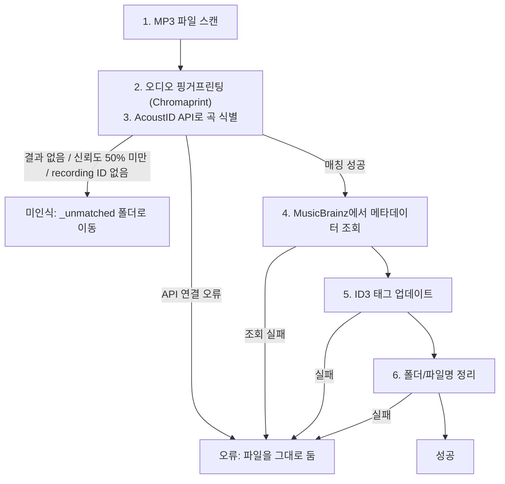

# MP3 Auto Organizer

[](https://www.python.org)
[](https://musicbrainz.org)
[](https://acoustid.org)
[](LICENSE)

오디오 핑거프린팅을 사용하여 MP3 파일의 메타데이터를 자동으로 인식하고, 태그 업데이트 및 폴더/파일명 정리를 수행하는 도구입니다.

## 주요 기능

- **오디오 핑거프린팅**: AcoustID + Chromaprint를 사용하여 음악 파일 자동 식별
- **메타데이터 자동 수집**: MusicBrainz에서 title, artist, album, track number 등 조회
- **ID3 태그 업데이트**: 수집된 메타데이터로 MP3 태그 자동 업데이트
- **파일 자동 정리**: `Artist/Album/01 - Title.mp3` 형식으로 폴더 구조 및 파일명 정리
- **NAS 지원**: SMB/VPN으로 마운트된 네트워크 드라이브 사용 가능

## 설치

### 1. 사전 요구사항

| 항목 | 설명 |
|------|------|
| Python 3.10 이상 | 코드가 Python 3.10 문법(`X \| None`)을 사용합니다 |
| Chromaprint (`fpcalc`) | 오디오 핑거프린트를 만드는 프로그램입니다 |

```bash
# Chromaprint 설치 (macOS)
brew install chromaprint

# Chromaprint 설치 (Ubuntu/Debian)
sudo apt install libchromaprint-tools

# fpcalc 설치 확인
fpcalc -version
```

### 2. Python 의존성 설치

```bash
python3 -m venv .venv
source .venv/bin/activate
pip install -r requirements.txt
```

### 3. API 키 발급

[AcoustID](https://acoustid.org/new-application)에서 무료 API 키를 발급받으세요.

### 4. 환경 설정

```bash
cp .env.example .env
```

`.env` 파일을 열어 값을 채웁니다.

| 변수 | 필수 | 설명 |
|------|------|------|
| `ACOUSTID_API_KEY` | 예 | AcoustID API 키 |
| `SOURCE_PATH` | 예 (`-s` 옵션으로 대신 지정 가능) | 스캔할 폴더 (예: `/Volumes/Music`) |
| `OUTPUT_PATH` | 아니요 | 정리된 파일을 옮길 폴더. 비워 두면 `SOURCE_PATH` 안에서 정리합니다 |

```bash
ACOUSTID_API_KEY=발급받은_키
SOURCE_PATH=/Volumes/Music
OUTPUT_PATH=
```

> **주의**: `ACOUSTID_API_KEY`를 `.env.example`의 예시 값 그대로 두면 안 됩니다. 이 값은 키 검사를 통과하기 때문에, 모든 파일이 인식 실패로 처리됩니다. 자세한 내용은 [알려진 문제](#알려진-문제)를 참고하세요.

`OUTPUT_PATH`를 지정하면 파일이 그 폴더로 **이동**합니다. 복사가 아닙니다.

## 사용법

명령은 저장소 루트 폴더에서 `python -m src.main` 형태로 실행합니다. `python src/main.py`로 실행하면 `ImportError`가 발생합니다.

```bash
# 가상환경 활성화
source .venv/bin/activate

# dry-run 모드로 미리보기 (기본값, 실제 변경 없음)
python -m src.main

# 실제로 변경 적용
python -m src.main --no-dry-run

# 특정 경로 지정
python -m src.main -s /path/to/mp3s

# 테스트 (5개 파일만 처리)
python -m src.main --limit 5 -v

# 상세 출력
python -m src.main -v
```

처음 사용할 때는 다음 순서를 권장합니다.

1. `python -m src.main --limit 5`로 몇 개 파일만 미리 봅니다.
2. 출력에서 아티스트와 곡 제목이 맞게 인식되는지 확인합니다.
3. 결과가 맞으면 `--no-dry-run`을 붙여 실제로 적용합니다.

### CLI 옵션

| 옵션 | 설명 |
|------|------|
| `-s`, `--source` | 스캔할 소스 경로 (`.env`의 `SOURCE_PATH`보다 우선) |
| `--dry-run` | 실제 변경 없이 미리보기만 (`config.yaml`보다 우선) |
| `--no-dry-run` | 실제로 변경 적용 (`config.yaml`보다 우선) |
| `-v`, `--verbose` | 상세 출력 (실제 적용 시 파일이 옮겨진 경로 표시) |
| `--limit N` | 최대 N개 파일만 처리 (테스트용) |
| `-c`, `--config` | 설정 파일 경로 (기본: 현재 폴더의 `config.yaml`) |

설정 값의 우선순위는 **CLI 옵션 > `.env` > `config.yaml`** 입니다.

## 처리 흐름



4단계에서는 MusicBrainz에 요청을 2번 보냅니다. 곡 정보를 한 번 조회하고, 트랙 번호를 알기 위해 앨범 정보를 한 번 더 조회합니다. MusicBrainz는 초당 1회로 요청을 제한하므로, 인식된 파일 하나에 최소 약 2초가 걸립니다.

## 처리 결과

실행이 끝나면 파일마다 다음 세 가지 중 하나의 상태가 표시됩니다.

| 상태 | 조건 | 파일 처리 |
|------|------|-----------|
| 성공 (✓) | 곡을 인식하고 태그 수정과 이동을 마침 | 태그 수정 후 새 경로로 이동 |
| 미인식 (?) | AcoustID 결과 없음, 신뢰도 50% 미만, MusicBrainz recording ID 없음 | `_unmatched` 폴더로 이동 (태그는 그대로) |
| 오류 (✗) | AcoustID 연결 오류, MusicBrainz 조회 실패, 태그 수정 실패, 파일 이동 실패 | 원래 위치에 그대로 둠 |

처리 결과는 `organizer.log` 파일에도 기록됩니다. 단, MusicBrainz 조회 실패와 recording ID 없음은 기록되지 않습니다.

## 정리 결과 예시

**Before:**
```
/Music/
  ├── track01.mp3
  ├── unknown.mp3
  └── 노래모음/
      └── song.mp3
```

**After:**
```
/Music/
  ├── BTS/
  │   └── Map of the Soul - 7/
  │       └── 01 - Black Swan.mp3
  ├── IU/
  │   └── LILAC/
  │       └── 03 - Coin.mp3
  └── _unmatched/
      └── unknown.mp3
```

트랙 번호를 찾지 못한 곡은 파일명이 `00 - 제목.mp3`가 됩니다.

## 업데이트되는 ID3 태그

| 태그 | 설명 |
|------|------|
| TIT2 | Title (곡 제목) |
| TPE1 | Artist (아티스트) |
| TPE2 | Album Artist (앨범 아티스트) |
| TALB | Album (앨범명) |
| TRCK | Track Number (트랙 번호, 예: `3/12`) |
| TPOS | Disc Number (디스크 번호) |
| TDRC | Year (발매년도) |
| TXXX | `MusicBrainz Recording Id`, `MusicBrainz Release Id` (내부 참조용) |

- TXXX를 뺀 나머지 태그 중 하나라도 바뀔 때만 파일을 저장합니다.
- 태그는 mutagen의 기본값인 ID3v2.4 형식으로 저장됩니다.

## 인식 실패 처리

인식하지 못한 파일은 `_unmatched` 폴더로 이동합니다.
**원본 폴더 구조가 유지됩니다.**

| 상황 | 처리 |
|------|------|
| 핑거프린트 매칭 실패 | `_unmatched` 폴더로 이동 |
| 매칭 신뢰도 50% 미만 | `_unmatched` 폴더로 이동 |
| AcoustID 결과에 MusicBrainz recording ID 없음 | `_unmatched` 폴더로 이동 |
| MusicBrainz 조회 실패 | 오류로 처리, 파일은 그대로 둠 |

```
# 원본 구조
/Music/
  └── 노래모음/
      └── unknown.mp3

# 처리 후
/Music/
  └── _unmatched/
      └── 노래모음/       ← 원본 폴더 구조 유지
          └── unknown.mp3
```

`_unmatched` 폴더와 `.backup` 폴더는 다음 실행 때 스캔에서 제외됩니다.

### 인식률 참고

| 유형 | 예상 인식률 |
|------|------------|
| 유명 곡 (빌보드, 멜론 차트 등) | ~100% |
| 인디/마이너 앨범 | 70~80% |
| 직접 녹음/편집 파일 | 인식 불가 |
| 라이브 버전/리믹스 | 원곡과 다르면 인식 실패 가능 |

`_unmatched` 폴더의 파일들은 수동으로 태그를 편집하거나, 기존 태그가 있다면 그대로 유지됩니다.

## 설정 파일

`config.yaml`에서 상세 옵션을 설정할 수 있습니다. API 키와 경로는 `.env`에서 설정합니다.

```yaml
# 폴더 구조 템플릿
folder_template: "{artist}/{album}"

# 파일명 템플릿
filename_template: "{track:02d} - {title}"

options:
  dry_run: true
  backup: true
  backup_path: ""
  unmatched_folder: "_unmatched"
  log_file: "organizer.log"
  sanitize_filenames: true
  duplicate_action: "rename"
```

### 템플릿 변수

| 템플릿 | 사용 가능한 변수 |
|--------|------------------|
| `folder_template` | `{artist}`, `{album}`, `{album_artist}`, `{year}` |
| `filename_template` | `{track}` (예: `{track:02d}`), `{title}`, `{artist}`, `{album}` |

폴더명과 파일명에서는 Windows에서 쓸 수 없는 문자(`<>:"/\|?*`)를 지웁니다.

### 옵션

| 옵션 | 기본값 | 설명 |
|------|--------|------|
| `dry_run` | `true` | `true`면 실제 변경 없이 미리보기만 합니다 |
| `backup` | `true` | 파일을 옮기기 전에 백업 폴더에 복사합니다 |
| `backup_path` | `""` | 백업 폴더. 비워 두면 `SOURCE_PATH/.backup` |
| `unmatched_folder` | `"_unmatched"` | 인식 실패 파일을 모을 폴더명 |
| `log_file` | `"organizer.log"` | 로그 파일 경로 (현재 폴더 기준) |
| `sanitize_filenames` | `true` | 현재 코드에서 사용하지 않습니다. 특수문자는 항상 지웁니다 |
| `duplicate_action` | `"rename"` | 현재 코드에서 사용하지 않습니다. 같은 이름의 파일이 있으면 항상 `이름 (1).mp3`처럼 번호를 붙입니다 |

## 프로젝트 구조

```
mp3-auto-organizer/
├── src/
│   ├── main.py          # CLI 진입점, 파일 1개 처리 흐름(process_file)
│   ├── scanner.py       # MP3 파일 탐색
│   ├── fingerprint.py   # AcoustID 핑거프린팅
│   ├── metadata.py      # MusicBrainz 메타데이터 조회
│   ├── tagger.py        # ID3 태그 업데이트
│   └── organizer.py     # 폴더/파일명 정리
├── config.yaml          # 설정 파일
├── .env.example         # 환경 변수 예시
├── .env                 # 환경 변수 (API 키 등, git에 올리지 않음)
└── requirements.txt     # Python 의존성
```

## 주의사항

- **dry-run 모드**: 기본값은 `dry_run: true`로, 실제 변경 없이 미리보기만 합니다. dry-run에서도 AcoustID와 MusicBrainz API는 호출합니다.
- **백업**: `backup: true`이면 인식에 성공한 파일을 옮기기 전에 백업 폴더에 복사합니다. 백업의 한계는 [알려진 문제](#알려진-문제)를 참고하세요.
- **빈 폴더 삭제**: 파일을 옮긴 뒤 비게 된 폴더는 자동으로 삭제됩니다.
- **네트워크 드라이브**: VPN/SMB로 마운트된 경로 사용 시 속도가 느릴 수 있습니다.
- **API 제한**: MusicBrainz는 초당 1회 요청 제한이 있어 자동으로 rate limiting을 적용합니다.

## 알려진 문제

아래 문제는 현재 코드에 있습니다. 실제 음악 폴더에 `--no-dry-run`을 실행하기 전에 확인하세요.

1. **API 키가 잘못되면 모든 파일이 `_unmatched`로 이동합니다.** AcoustID가 오류 응답을 보내도, 코드는 이를 "인식 실패"로 처리합니다. `.env.example`의 예시 값(`your_api_key_here`)은 키 검사를 통과합니다.
2. **백업에는 원본 태그가 남지 않습니다.** 백업은 태그를 수정한 다음에 만들어집니다.
3. **백업 파일이 서로 덮어써질 수 있습니다.** 백업은 폴더 구조 없이 파일명으로만 저장됩니다. 다른 폴더에 같은 이름의 파일이 있으면, 나중 파일이 앞 파일의 백업을 덮어씁니다.
4. **인식 실패 파일은 백업하지 않습니다.** `_unmatched`로 옮길 때는 백업을 만들지 않습니다.
5. **소스 폴더 자체가 지워질 수 있습니다.** `OUTPUT_PATH`를 따로 지정해서 모든 파일이 옮겨지면, 비게 된 `SOURCE_PATH` 폴더도 삭제됩니다.
6. **`unmatched_folder` 이름을 바꾸면 다음 실행 때 다시 스캔됩니다.** 스캔에서 제외하는 폴더명은 `_unmatched`와 `.backup`으로 고정되어 있습니다.

## 라이선스

[MIT License](LICENSE)
